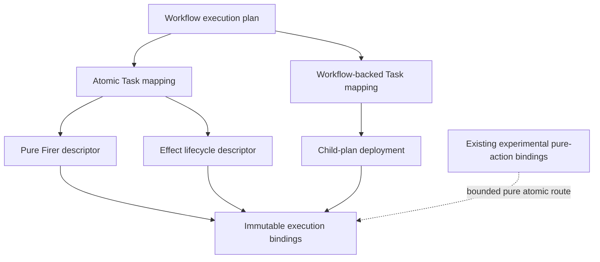

# `WorkflowExecutionBindings` schematic

## Responsibility

Complete mappings are ordered and content-bound. Deployment can substitute
neither plan-selected Task semantics nor child targets. Live implementations
remain outside the artifact.
