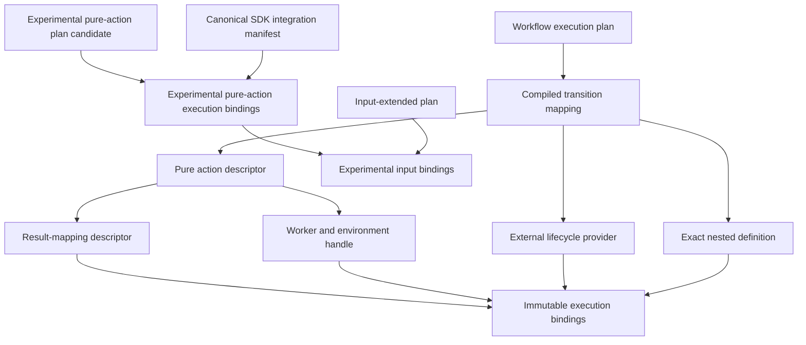

# `WorkflowExecutionBindings` schematic

## Responsibility

The pure result-mapping descriptor fixes the correspondence among owner logical
output roles, evidence roles, and declared CPN external variables. For the QE
SCF artifact-set direction it distinguishes `artifact_set_identity` output from
canonical `artifact_set` evidence.

The experimental base path verifies only that the manifest contains the exact
firer descriptor already selected by the bounded plan candidate. The
input-binding wrapper additionally requires the input-extended plan to retain
that exact base plan. Deployment can substitute neither the selected-binding
profile, output mapping, nor input-source mappings.

Complete mappings are ordered and content-bound. Changing the provider, identity
codec, mapping revision, or environment produces another binding artifact; it
never mutates the compiled plan or reinterprets retained evidence.
