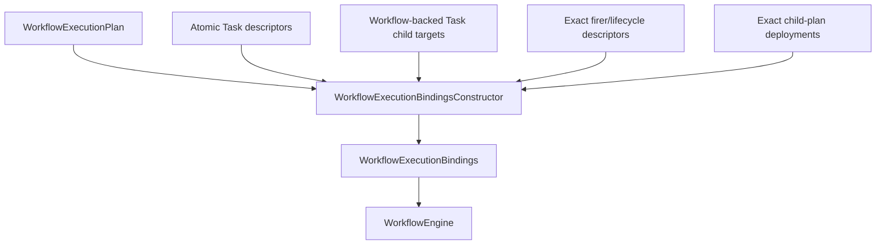

# `projectkoios.workflow.compilation.bindings` schematic

## Responsibility

Durable bindings contain descriptor identities and opaque handles only. Live
implementations and provider-specific resources remain outside retained plans
and compact runtime state.
