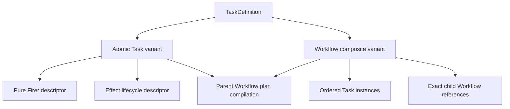

# `TaskDefinition` schematic

## Responsibility

The compiler maps each Task definition completely. Runtime activity never uses a
Task definition identity as a substitute for occurrence or attempt identity.
