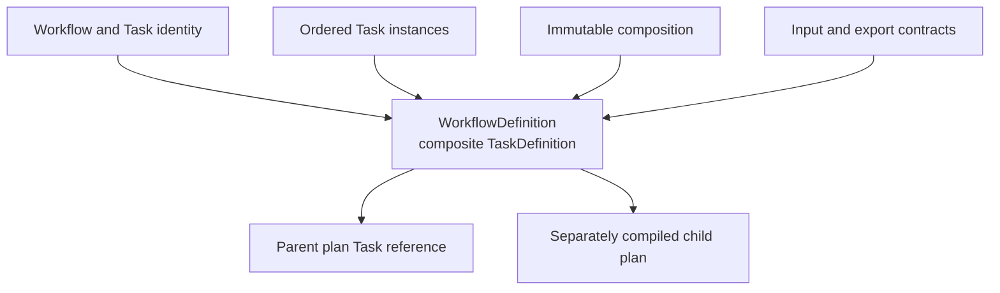

# `WorkflowDefinition` schematic

## Responsibility

The same immutable Workflow definition can be compiled as a root or referenced
as a Task target. No retained arrow returns to a mutable source owner.
