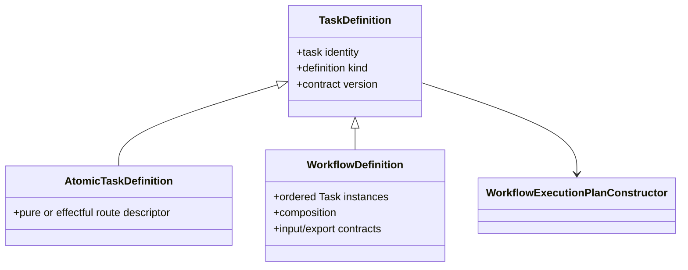

# `projectkoios.workflow.compilation.definitions` schematic

## Responsibility

Definition equality is structural and content-bound. A source-owner change
creates another definition identity rather than mutating retained state.
