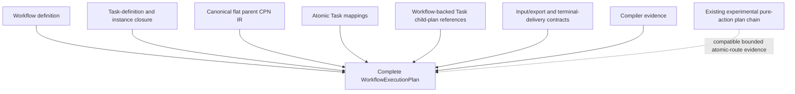

# `WorkflowExecutionPlan` schematic

## Responsibility

The complete plan has no live runtime objects. Child plans and deployment
bindings remain separate artifacts; the current experimental pure-action plans
do not claim complete iteration-2 conformance.
