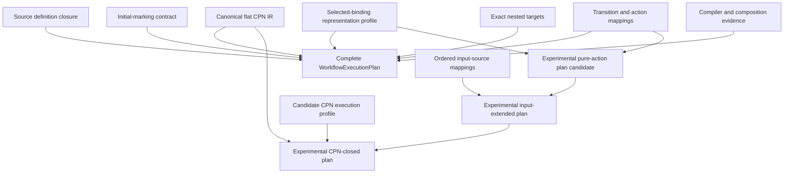

# `WorkflowExecutionPlan` schematic

## Responsibility

The base experimental candidate closes the selected-binding profile and one
exact output-mapping descriptor. The input-extended wrapper additionally closes
one source kind, source profile, and mapping version per ordered SDK input role.
The CPN-closed candidate additionally binds exact canonical definition bytes and
a candidate execution profile. None is sufficient to start or replay a workflow
under the complete contract. The complete plan contains no live runtime objects
and remains separate from deployment linking.
