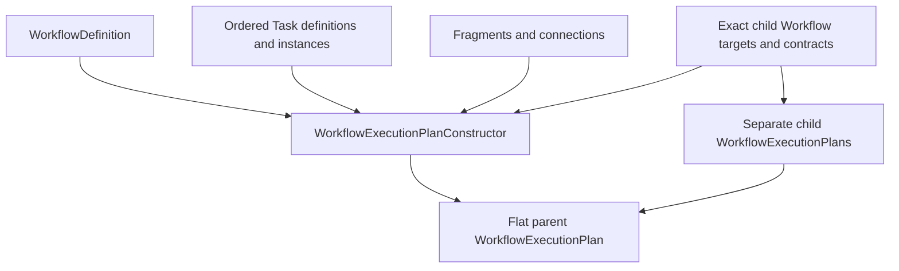

# `projectkoios.workflow.compilation.planning` schematic

## Responsibility

The parent plan retains source and composition evidence plus exact references to
separately compiled child plans. It does not contain child markings or history.
