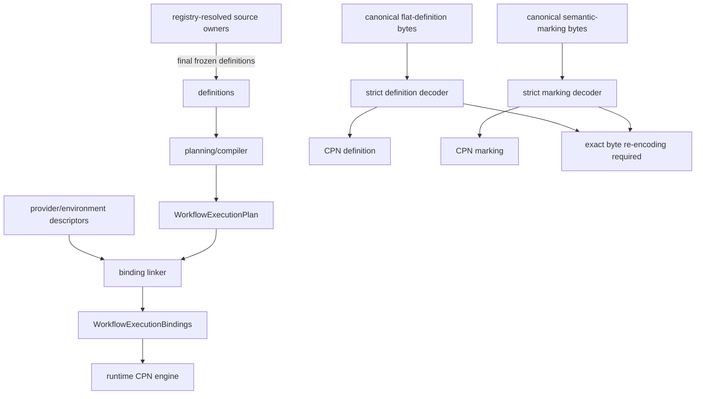

# `projectkoios.workflow.compilation` schematic

## Responsibility

Discovery occurs before compilation and linking. Runtime receives exact artifacts
and performs no identity-only inference. Representation decoding reconstructs
candidate semantic objects but does not itself grant runtime authority.
