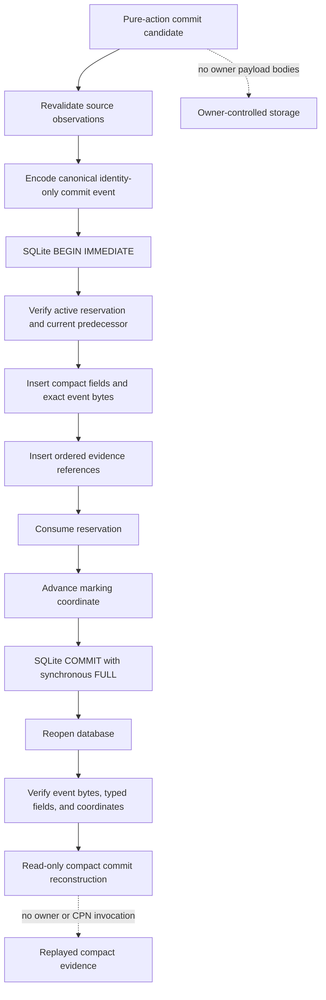

# `projectkoios.workflow.persistence` schematic

## Responsibility

The experimental repository and replay service cover durable reservation,
compact atomic commit, and structural identity-chain replay only. Complete CPN
and runtime safety-state replay remains separate work.
