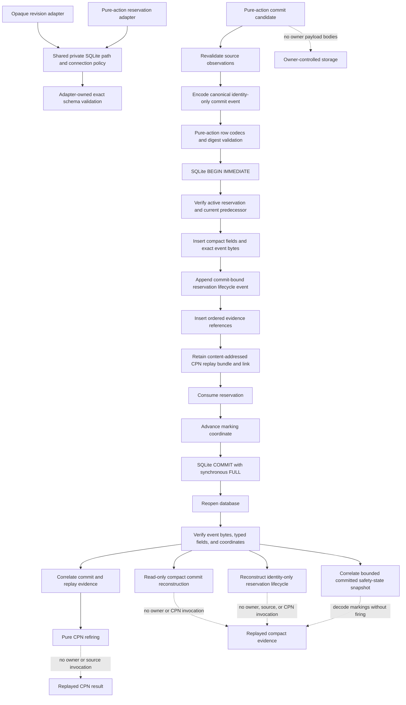

# `projectkoios.workflow.persistence` schematic

## Responsibility

Both SQLite adapters share private-file and connection security policy while
retaining separate schemas and transaction orchestration. The experimental
pure-action repository and replay services cover durable reservation, compact
atomic commit, structural identity-chain replay, and bounded pure-CPN transcript
refiring. Complete request/result history, reservation lifecycle, and runtime
safety-state replay remain separate work.
