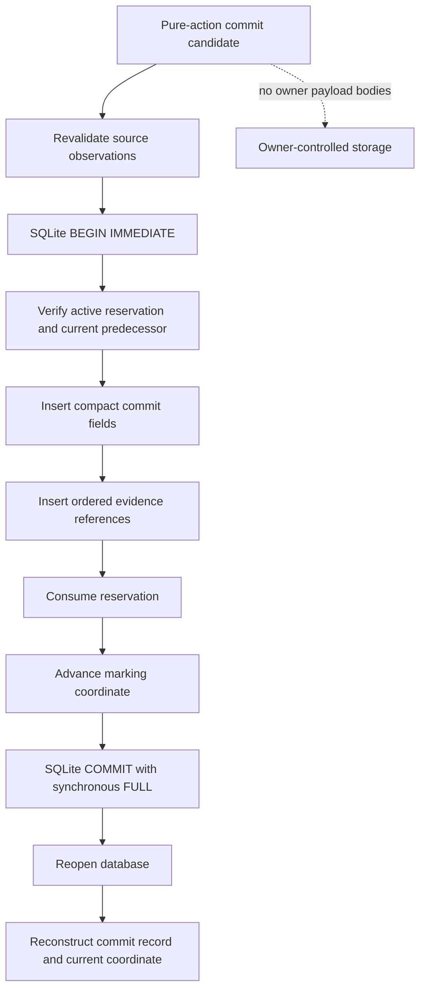

# `projectkoios.workflow.persistence` schematic

## Responsibility

The experimental repository covers durable reservation and compact atomic
commit only. Canonical committed-event replay and complete workflow history
remain separate work.
