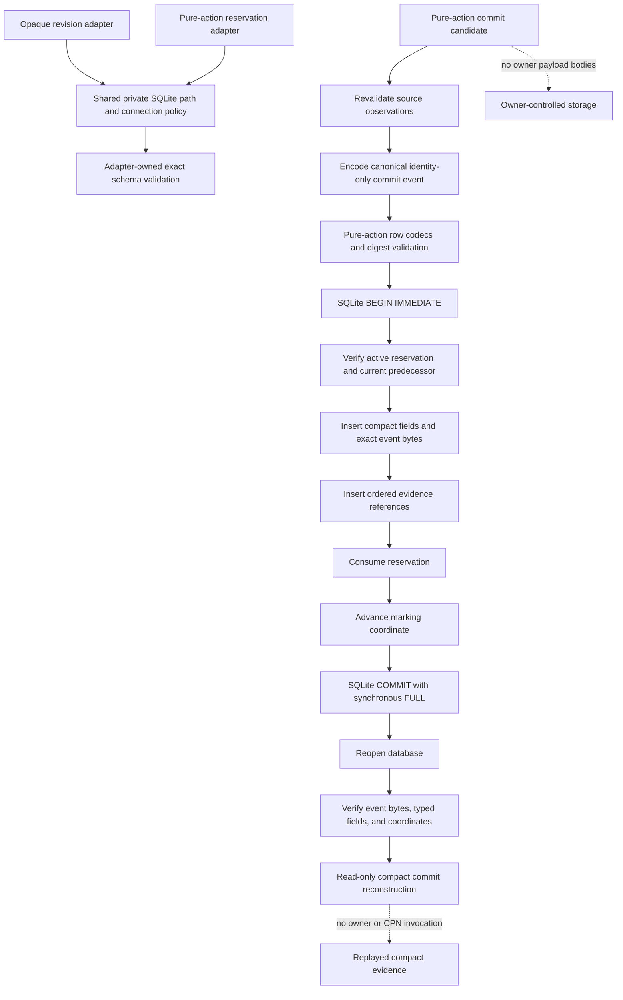

# `projectkoios.workflow.persistence` schematic

## Responsibility

Both SQLite adapters share private-file and connection security policy while
retaining separate schemas and transaction orchestration. The experimental
pure-action repository and replay service cover durable reservation, compact
atomic commit, and structural identity-chain replay only. Complete durable CPN
and runtime safety-state replay remains separate work.
