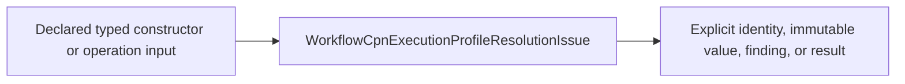
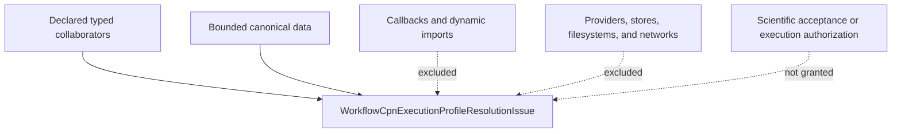

# `WorkflowCpnExecutionProfileResolutionIssue` schematics

## Local contract flow

The arrows show typed data composition, not runtime scheduling.

## Coordination and authority boundary

## Ownership

`WorkflowCpnExecutionProfileResolutionIssue` owns only its source-declared behavior. Coordinators may correlate
it with other contracts but cannot copy its semantics, recursively inline child
topology, or infer authorization from successful construction.
