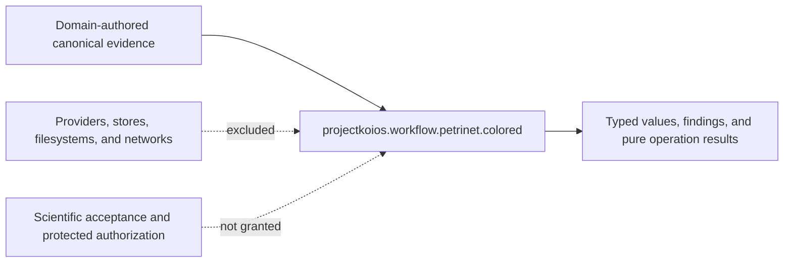

# `projectkoios.workflow.petrinet.colored` schematics

## Composition map

```mermaid
flowchart TD
    owner["projectkoios.workflow.petrinet.colored"]
    owner --> child0["bindings"]
    owner --> child1["canonical"]
    owner --> child2["children"]
    owner --> child3["closure"]
    owner --> child4["control"]
    owner --> child5["definitions"]
    owner --> child6["deployments"]
    owner --> child7["enablement"]
    owner --> child8["expressions"]
    owner --> child9["external_outputs"]
    owner --> child10["firing"]
    owner --> child11["mappings"]
    owner --> child12["markings"]
    owner --> child13["payloads"]
    owner --> child14["plans"]
    owner --> child15["profiles"]
    owner --> child16["routes"]
    owner --> child17["selection"]
    owner --> child18["shadow"]
    owner --> child19["validation"]
    owner --> child20["values"]
```

Arrows denote ownership and composition, not scheduling or transferred
authority. Each child retains its local invariants.

## Coordination and authority boundary

## Strategy

The package validates bounded inputs, derives content identity, invokes an
explicit semantic operation, and retains correlated output. It does not reduce
CPN execution to a DAG or recursively embed child topology.
