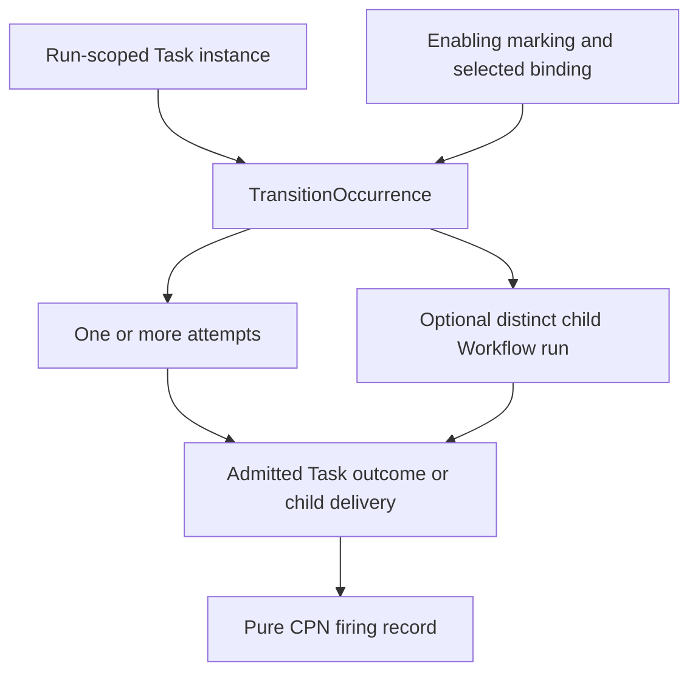

# `TransitionOccurrence` schematic

## Responsibility

A later cyclic re-enablement is a distinct occurrence even for the same Task and
transition. Task, occurrence, attempt, child run, and firing identities remain
separate.
