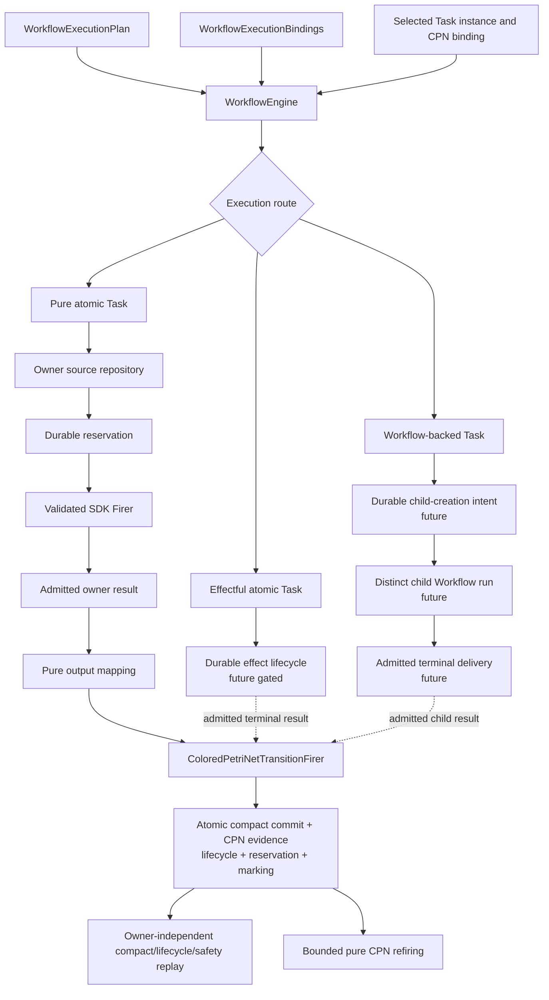

# `WorkflowEngine` schematic

## Responsibility

Only the pure atomic Task route is implemented by the current bounded
experimental chain. It repeatedly validates source and predecessor authority,
admits only a correlated SDK success, invokes the pure CPN firer, and commits
compact state plus canonical CPN replay evidence atomically.

Effect lifecycle and child-run orchestration remain future gated routes. Neither
may be hidden behind `Firer`. A child Workflow remains separately compiled and
persisted; only its admitted terminal delivery reaches the parent firing.

Owner payload bodies, native files, numerical arrays, private locators, and
provider resources do not enter the compact commit or CPN transcript.
