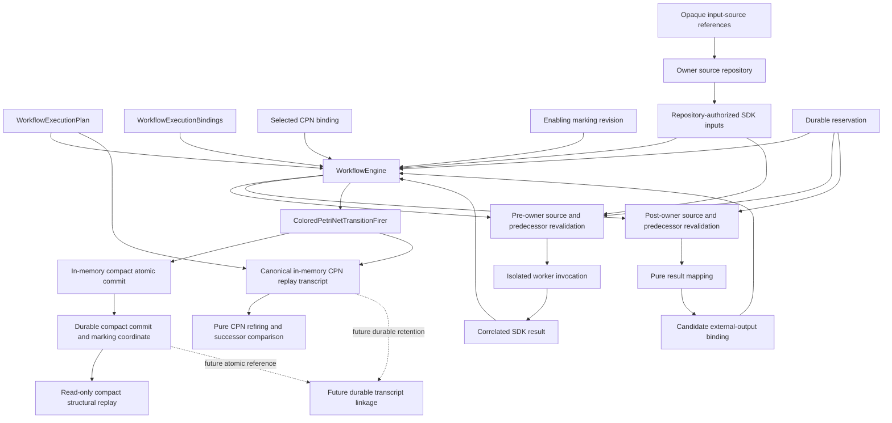

# `WorkflowEngine` schematic

## Responsibility

The engine admits the candidate external binding only after rechecking result
correlation, descriptor and mapping identities, the exact predecessor revision,
the selected binding, and its reservation. Failure at any check prevents CPN
firing. Authoritative input resolution does not import owner storage or private
locators. The durable compact commit consumes the reservation and advances the
marking coordinate atomically while retaining identity-only event bytes.

Compact structural replay does not invoke the CPN. The separate bounded
transcript reconstructs canonical CPN state and proves pure refiring under the
exact supported retained profile without invoking the owner. It is currently
in-memory only; durable transcript retention and atomic linkage to the compact
commit remain future work.

For the artifact-set direction, the external binding carries only the opaque
owner logical-identity string. Owner payload bodies, canonical artifact-set
evidence documents, private locators, and native files do not enter the CPN
transcript or compact commit event.
