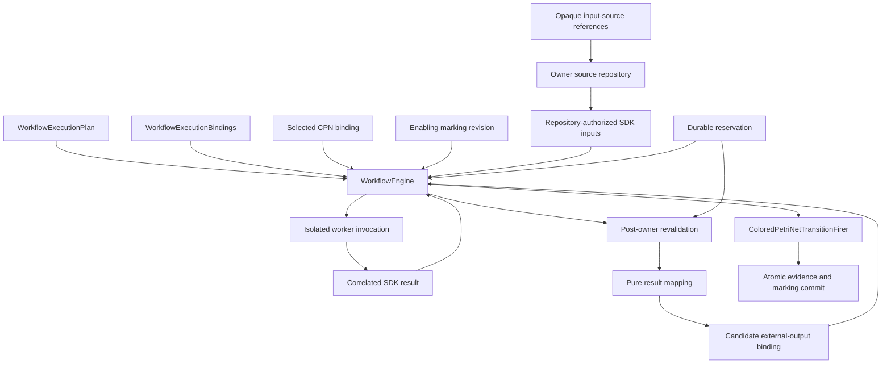

# `WorkflowEngine` schematic

## Responsibility

The engine admits the candidate external binding only after rechecking result
correlation, descriptor and mapping identities, the exact predecessor revision,
the selected binding, and its reservation. Failure at any check prevents CPN
firing. The current experimental authority candidate resolves opaque input
references without importing owner storage or locators, and reservation reloads
the exact source observation. The reservation candidate covers request closure,
atomic in-memory reservation, and revalidation only; the durable reservation
and atomic firing commit shown here remain future work.

For the artifact-set direction, the external binding carries the owner logical
identity string. The SDK request, result, canonical artifact-set evidence,
payload digests, candidate binding, firing result, successor marking, and
occurrence history enter the same accepted persistence boundary.
