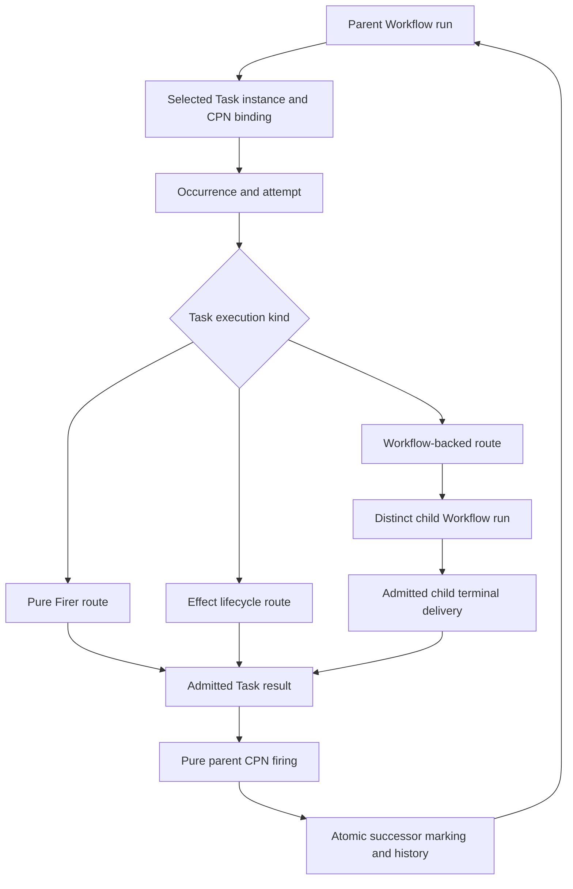

# `projectkoios.workflow.runtime` schematic

> **Status: provisional architecture iteration 2.**

## Responsibility

Long-running effects and child execution never hold a database transaction.
Exact reservations and compare-and-swap protect parent firing. Rejected,
failed, ambiguous, cancelled, or unadmitted child outcomes cannot fabricate a
successful Task result or domain transition.
