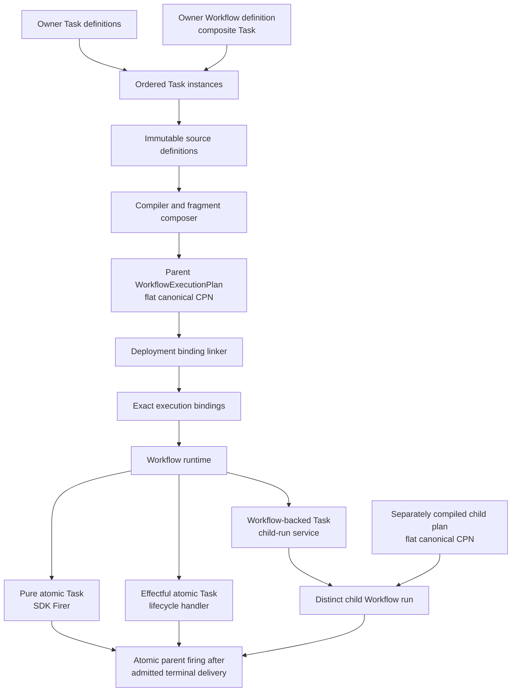

# `projectkoios.workflow` schematic

> **Status: provisional architecture iteration 2.** The composition model is a
> target informed by owner evidence; implemented SDK alpha types remain narrower.

## Responsibility

This schematic separates owner Task definitions, Workflow composition,
compilation, deployment linking, and the three execution routes.

A parent composition sees every member as a Task. The workflow-backed route does
not merge child topology or history into the parent. It retains a distinct child
run and admits only an explicitly correlated terminal delivery before the
parent's pure CPN firing.

Owner-specific implementations remain outside retained generic state. For
example, QE and VASP may specialize one Simulations Task role with different
resources and handlers while the parent SCF Workflow remains calculator-neutral.
Registry discovery precedes compilation and linking; runtime receives exact
artifacts and performs no provider discovery.
