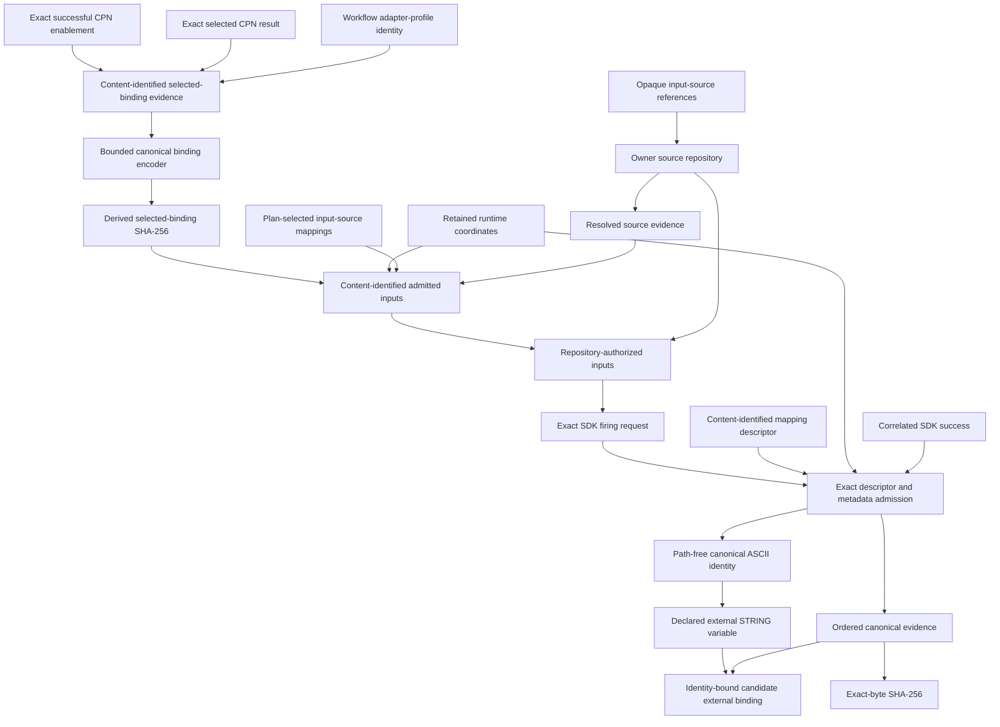

# `TransitionActionBinding` schematic

## Responsibility

The selected-binding evidence prevents a bare arbitrary binding from entering
request construction. The admitted-input aggregate additionally prevents the
reservation service from independently combining raw owner payloads with that
selection. The authorization service resolves opaque references through a
nominal owner/source repository, and reservation revalidates those exact source
observations. Private storage and locators remain owner-controlled; predecessor
authority remains the separate reservation boundary.

For the QE SCF artifact-set direction, the identity branch carries the opaque
`artifact_set_identity` string and the evidence branch carries the canonical
`artifact_set` document. The two identities are deliberately different: one is
owner semantic state and the other binds exact evidence bytes.

The result mapping is versioned with the action descriptor so a changed adapter
cannot reinterpret a retained result during replay. This pure mapping produces
a candidate external-output binding; only `WorkflowEngine` may admit it against
the reserved predecessor and request CPN firing.
