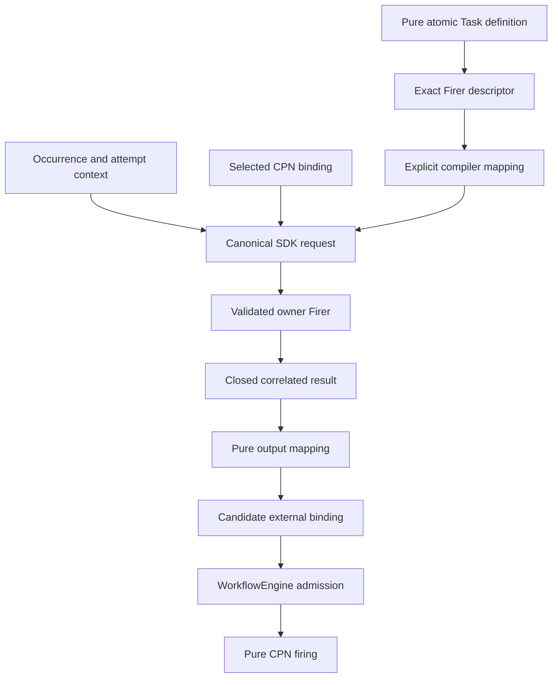

# `projectkoios.workflow.sdk.actions` schematic

## Responsibility

The action/firer performs one pure atomic Task operation. It is not the durable
Task definition, an effect lifecycle, a workflow-backed Task, or the CPN firer.
Rejection and failure never masquerade as successful CPN firing.
