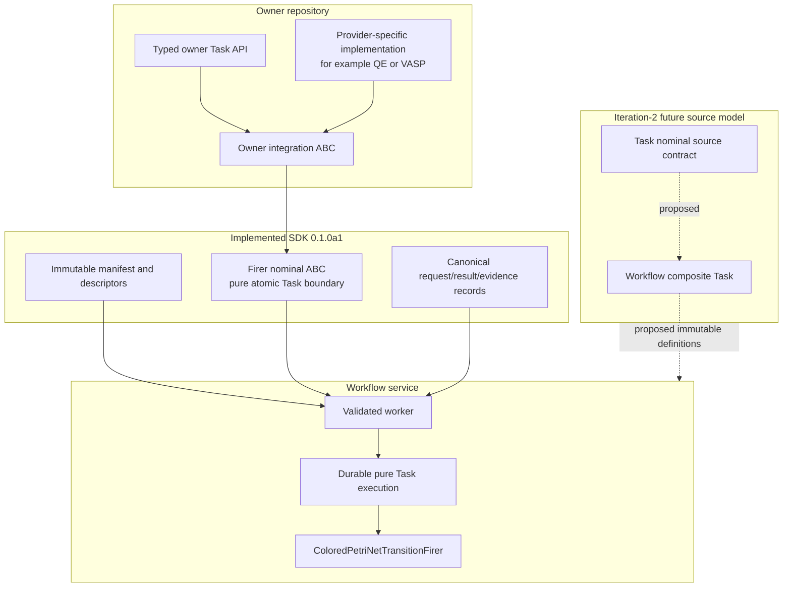

# `projectkoios.workflow.sdk` schematic

## Responsibility

The implemented SDK points outward only through immutable records and nominal
ABCs. The proposed Task/Workflow source model is not part of `0.1.0a1` and does
not authorize effects or owner migration.
