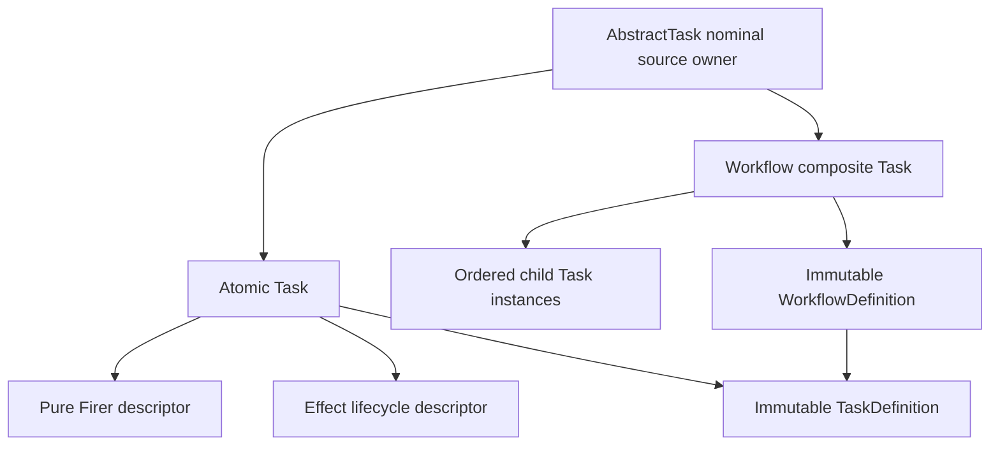

# `AbstractTask` schematic

## Responsibility

Exactly one specialization shape is admitted. Route and composition declarations
control compilation and linking but never replace CPN enablement, selection, or
firing semantics.
