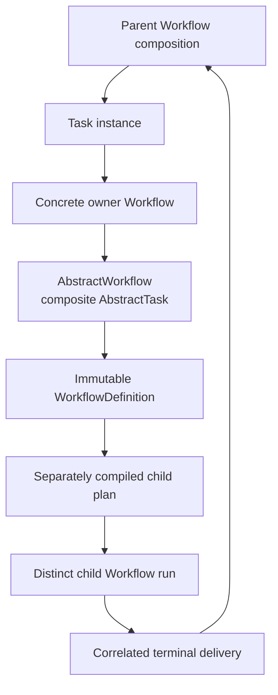

# `AbstractWorkflow` schematic

## Responsibility

The parent sees one Task instance. Definition construction and child execution
remain separate; no arrow returns from retained state to a mutable owner object.
