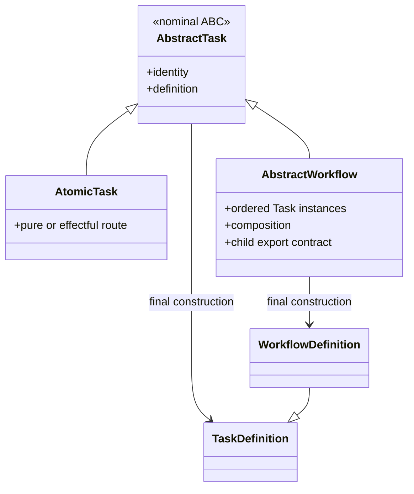

# `projectkoios.workflow.sdk.source` schematic

## Responsibility

A parent source composition stores Tasks only. A Workflow source is therefore a
Task source to its parent, but its definition retains composition rather than an
atomic execution route. Live owners end at immutable definition construction.
